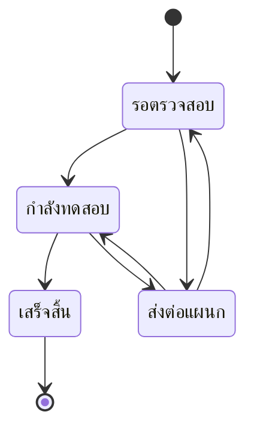
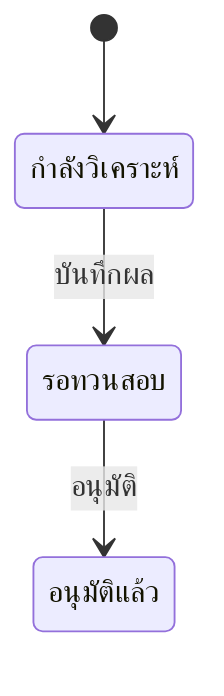

# Thanes LIMS — เอกสารข้อกำหนดระบบ (สำหรับนำเสนอผู้ใช้งาน)

ระบบบริหารจัดการห้องปฏิบัติการ (Laboratory Information Management System: LIMS) ของ Thanes
ใช้ติดตามตัวอย่างตั้งแต่รับเข้า ทดสอบ จนถึงจัดเก็บ รวมถึงดูแลเครื่องมือ วัสดุ เอกสาร และอุปกรณ์เฝ้าระวังอุณหภูมิ

> **สถานะเอกสาร:** ร่างเพื่อรับฟังความเห็นผู้ใช้ — เนื้อหาในหัวข้อ 4 คือสิ่งที่ใช้งานได้จริงแล้ว
> ส่วนที่ยังไม่พร้อมอยู่ในหัวข้อ 6 และคำถามที่ต้องการให้ผู้ใช้ยืนยันอยู่ในหัวข้อ 7

---

## 1. ภาพรวมและวัตถุประสงค์

| วัตถุประสงค์ | สิ่งที่ระบบทำให้ |
|---|---|
| รู้ว่าตัวอย่างอยู่ที่ไหน ใครดูแล | ทะเบียนตัวอย่าง + ตำแหน่งจัดเก็บถึงระดับช่องในกล่อง + สติกเกอร์บาร์โค้ด |
| เครื่องมือพร้อมใช้ตามมาตรฐาน | ตารางสอบเทียบ/บำรุงรักษา สถานะเตือนล่วงหน้า และเอกสารรับรอง |
| วัสดุไม่ขาด ตรวจย้อนกลับได้ | คลังวัสดุแยกตามล็อต วันหมดอายุ รับเข้า-เบิกออก |
| เอกสารเป็นระเบียบ | คลังเอกสารพร้อมประวัติเวอร์ชันและดูตัวอย่างในหน้าเดียว |
| ติดตามผลทดสอบ | สั่งทดสอบ บันทึกผล ทวนสอบ อนุมัติ |
| ถามข้อมูลได้เร็ว | ผู้ช่วย AI ตอบคำถามจากข้อมูลในระบบ (อ่านอย่างเดียว) |

ระบบใช้งานผ่านเว็บเบราว์เซอร์ รองรับทั้งคอมพิวเตอร์และมือถือ

## 2. ผู้ใช้งานและบทบาท

| บทบาท | หมายเหตุ |
|---|---|
| ผู้ดูแลระบบ (Admin) | จัดการผู้ใช้ และดูข้อมูลย้อนหลังของอุปกรณ์ SMTrack+ ได้ |
| ผู้จัดการห้องปฏิบัติการ | — |
| ประกันคุณภาพ (QA) | — |
| นักวิทยาศาสตร์ | — |
| ทั่วไป | — |

**สิทธิ์ที่ยืนยันแล้ว**
- เมนู "การจัดการผู้ใช้งาน" เห็นและใช้ได้เฉพาะผู้ดูแลระบบ
- ปุ่มบันทึกผลการสอบเทียบ ต้องมีสิทธิ์ "อนุมัติ" ของเครื่องมือ
- ปุ่มบันทึกการบำรุงรักษา ต้องมีสิทธิ์ "แก้ไข" ของเครื่องมือ
- ส่วนอื่นระบบหลังบ้านเป็นผู้ตรวจสิทธิ์ หากไม่มีสิทธิ์จะแสดงข้อความแจ้ง
- ตารางสิทธิ์รายบทบาทแบบเต็มกำหนดโดยผู้ดูแลระบบ (ดูหัวข้อ 7)

ผู้ใช้เข้าสู่ระบบด้วยอีเมลและรหัสผ่าน หากหมดเวลาใช้งานระบบจะพากลับหน้าเข้าสู่ระบบ
บัญชีที่ถูกระงับจะเข้าสู่ระบบไม่ได้

## 3. แนวคิดและคำศัพท์หลัก

| คำไทย (อังกฤษ) | ความหมาย |
|---|---|
| ตำแหน่งจัดเก็บ (Location) | จุดในโครงสร้างที่ตัวอย่างวางอยู่ได้ |
| ตู้ / ชั้น / ช่อง / ช่องย่อย (Cabinet / Shelf / Slot / Sub-slot) | ระดับของต้นไม้ตำแหน่งตัวอย่าง จากบนลงล่าง |
| กล่อง (Box) และ ช่อง (Cell) | กล่องมีตาราง (Grid) แถว×คอลัมน์ ตั้งชื่อช่องแบบไมโครเพลต เช่น A1, H12 ขยายได้อย่างเดียว ลดไม่ได้ |
| ที่เก็บตัวอย่างโดยตรง (Leaf) | ตำแหน่งที่ไม่มีลูกและไม่ใช่กล่อง เก็บได้ทีละ 1 ตัวอย่าง |
| การจัดเก็บเข้าตำแหน่ง (Put-away) | การนำตัวอย่างไปวางที่ตำแหน่งหรือช่อง แยกจากการรับตัวอย่างเข้า |
| รหัสบาร์โค้ด (Barcode ID) | รหัสเสริมของตัวอย่าง พิมพ์เองหรือให้ระบบสร้าง ไม่ซ้ำกัน |
| สติกเกอร์ (Sticker) | ป้ายบาร์โค้ด (PDF) หลายขนาด 1D/2D ถ้าไม่มี Barcode ID จะใช้รหัสตัวอย่างแทน |
| ผู้ดูแล (Custodian) | ผู้ใช้ในระบบที่รับผิดชอบตัวอย่าง เครื่องมือ หรือรายการวัสดุ เลือกจากรายชื่อเท่านั้น |
| ผู้ผลิต (Manufacturer) | ชื่อผู้ผลิตเฉย ๆ ไม่มีข้อมูลติดต่อ |
| ผู้ขาย (Vendor) | ข้อมูลหลักของผู้ขาย/ผู้ให้บริการ มีข้อมูลติดต่อ ใช้ซ้ำได้ทุกฟอร์ม |
| รอบสอบเทียบ (Calibration Schedule) | แผนสอบเทียบหนึ่งรายการของเครื่อง เครื่องหนึ่งมีได้หลายรอบ |
| บันทึกการสอบเทียบ (Calibration Event) | การสอบเทียบที่ทำจริง แก้ประวัติไม่ได้ ถ้าผิดให้บันทึกรายการใหม่ |
| ใบรับรอง (Certificate) | เอกสารของการสอบเทียบหนึ่งครั้ง |
| รอบบำรุงรักษา / บันทึกการบำรุงรักษา (Maintenance Schedule / Event) | โครงสร้างเดียวกับสอบเทียบ |
| ล็อต (Inventory Lot) | วัสดุหนึ่งชุดการผลิต มีเลขล็อต วันหมดอายุ จำนวนของตัวเอง จำนวนคงเหลือคือผลรวมทุกล็อต |
| รับเข้า (Receiving) / เบิก (Stock Issue) | ทางเดียวที่สต็อกเพิ่ม/ลด |

## 4. โมดูลและฟังก์ชัน

### 4.1 แดชบอร์ด
- ตัวเลขสรุป 4 รายการ: ตัวอย่างที่ยังใช้งาน, เครื่องมือที่ต้องสอบเทียบ/บำรุงรักษา, การแจ้งเตือนสภาพแวดล้อม, ผลทดสอบที่รออนุมัติ
- การ์ดสถานะสอบเทียบและบำรุงรักษา และทางลัดไปทุกโมดูล
- มีกระดิ่งแจ้งเตือน (อ่านทีละรายการหรืออ่านทั้งหมด) และสลับธีมสว่าง/มืดได้

### 4.2 การจัดการตัวอย่าง
**ทำอะไรได้**
- ดูทะเบียนตัวอย่าง และเปิดรายละเอียดแต่ละรายการ
- **กรอง:** สแกนบาร์โค้ด (กด Enter, หากไม่พบรหัสจะแจ้งเตือนสีแดงและไม่ล้างข้อความ), ค้นหาตู้/ตำแหน่ง, เลือกผู้ดูแล, แยกสถานะ
- **เพิ่มตัวอย่าง (2 ขั้นตอน):** กรอก/สร้าง Barcode ID, เลือกผู้ดูแลจากรายชื่อ, ใส่รายละเอียดเพิ่มเติม
- **พิมพ์สติกเกอร์** เปิดป้ายเป็น PDF ครั้งละหนึ่งตัวอย่าง
- **จัดเก็บ/ย้ายตำแหน่ง** โดยสแกนบาร์โค้ดของตู้หรือตำแหน่ง ถ้าสแกนตำแหน่งที่ยังมีลูก ระบบจะให้เลือกต่อในกลุ่มนั้น
- **เปลี่ยนสถานะ** ได้เฉพาะลำดับที่อนุญาต
- **ประวัติการดูแล (Chain of Custody)** แสดงเป็นไทม์ไลน์

ตัวอย่างที่ "ส่งต่อแผนก" ถือว่าออกจากห้องแล็บแล้ว จะไม่กินที่ในตำแหน่ง/ช่องอีก

### 4.3 ตำแหน่งจัดเก็บ
- เบราว์เซอร์ 3 แผง: ต้นไม้ตำแหน่ง | เนื้อหาของโหนด หรือตารางช่องของกล่อง | รายละเอียด (ปรับขนาดแผงได้ บนมือถือซ้อนเป็นแนวตั้ง)
- **สองต้นไม้:**
  - ต้นไม้ตัวอย่าง: ตู้ → ชั้น → ช่อง → ช่องย่อย (มีกล่องเป็นจุดสิ้นสุดได้) แต่ละที่เก็บได้ทีละหนึ่งตัวอย่าง
  - ต้นไม้เครื่องมือ/วัสดุ: อาคาร → ห้อง → โซน → ตู้ → ชั้น ไม่จำกัดจำนวน
- สร้างระดับถัดไปเป็นชุด ด้วยคำนำหน้าชื่อ + จำนวน
- กล่อง: ตั้งตาราง (มีทางลัด 96 = 8×12 และ 81 = 9×9) ลากวางเพื่อย้ายตัวอย่างภายในกล่อง สลับหรือย้ายเป็นกลุ่มสำเร็จทั้งหมดหรือไม่สำเร็จเลย
- ทุกโหนดมีบาร์โค้ดตำแหน่ง สแกนแล้วไปที่โหนดทันที แสดงเส้นทางเต็ม เช่น "ตู้แช่-A / ชั้น-2 / ช่อง-4" และเปลี่ยนตามเมื่อเปลี่ยนชื่อ

### 4.4 การจัดการเครื่องมือ
- ทะเบียนเครื่องมือ ค้นหาตามชื่อหรือ S/N แสดงสถานะรวมและตัวเลขสรุป
- **เพิ่มเครื่องมือ:** S/N, ประเภท, ผู้ผลิต, รุ่น, ตำแหน่ง, วันติดตั้ง, ผู้ขาย (และข้อมูลติดต่อ), แนบบัตรรับประกัน
- **หน้ารายละเอียด:** รอบสอบเทียบและบำรุงรักษา (มีได้หลายรอบ ตั้งให้ทำซ้ำได้), ประวัติทั้งหมด, เอกสาร
- **บันทึกการสอบเทียบ:** วันที่ ประเภท ค่าที่วัดได้ ค่ายอมรับ ผลผ่าน/ไม่ผ่าน ผู้ทำ แนบใบรับรอง
- **บันทึกการบำรุงรักษา:** วันที่ ประเภท ผล (ผ่าน/ไม่ผ่าน/ไม่ระบุ) ผู้ให้บริการ หมายเหตุ
- บันทึกแล้วรอบที่ทำซ้ำจะเลื่อนวันครบกำหนดถัดไปให้เอง
- **หน้าผลการสอบเทียบรวม:** ค้นหาและกรองผลของทุกเครื่องในที่เดียว

| สถานะ | ความหมาย |
|---|---|
| พร้อมใช้ | ยังไม่ถึงกำหนด |
| ใกล้ครบกำหนด | ภายใน 14 วัน |
| เลยกำหนด | เกินกำหนด |
| ยังไม่ตั้งรอบ | ไม่มีแผน (ไม่เท่ากับพร้อมใช้) |

สถานะรวมของเครื่องคือด้านที่แย่กว่าระหว่างสอบเทียบกับบำรุงรักษา ระบบคำนวณสดทุกครั้งที่เปิดดู

### 4.5 อุปกรณ์เฝ้าระวัง SMTrack+ (สภาพแวดล้อม)
- การ์ดอุปกรณ์แสดงค่าล่าสุด สถานะออนไลน์/ออฟไลน์ ข้อมูลล่าช้า และปิดใช้งาน เพิ่ม/แก้ไขอุปกรณ์ได้
- หน้าข้อมูลย้อนหลัง (กราฟ 1 / 7 / 30 วัน และตารางค่าที่วัด) **จำกัดเฉพาะผู้ดูแลระบบ**
- ข้อมูลอ่านสดจาก SMtrack ไม่ได้เก็บซ้ำในระบบนี้

### 4.6 คลังวัสดุ
- ตารางสต็อกพร้อมตัวเลขสรุป กราฟสัดส่วนหมวด และใบสั่งซื้ออัตโนมัติ
- **สถานะสต็อก:** เพียงพอ / ใกล้หมด / สั่งซื้อด่วน / หมด
- **เพิ่มรายการ:** ผู้ดูแล, ผู้ผลิต, ตำแหน่ง, ผู้ขาย (เพิ่มผู้ขายใหม่ได้ในฟอร์มเดียวกัน)
- **รับเข้า (หน้าแยก):** ค้นหารายการ ใส่เลขล็อต วันหมดอายุ จำนวน ถ้าเลขล็อตมีอยู่แล้วจะเติมเข้าล็อตเดิม แสดงล็อตที่มีอยู่
- **เบิก:** ผู้เบิกระบุล็อตเอง ระบบไม่เลือกให้ ถ้าขอเกินที่มีในล็อต ระบบจะถามว่าจะเบิกส่วนที่เหลือจากล็อตอื่น หรือยืนยันเบิกต่อ (ล็อตจะติดลบเพื่อให้ความไม่ตรงกันระหว่างของจริงกับระบบมองเห็นได้)
- **ใบสั่งซื้อ:** รออนุมัติ → ส่งให้ผู้ขายแล้ว → ได้รับแล้ว (หรือยกเลิก) ดูประวัติได้ แสดงอย่างเดียว

### 4.7 เอกสาร
- คลังเอกสารแบบ 2 แผง: รายการ | ตัวอย่างไฟล์
- อัปโหลดเอกสาร ดูประวัติเวอร์ชัน มีตัวบอกเอกสารที่ถูกล็อกหรือจำกัดการเข้าถึง
- ดูตัวอย่างในหน้าได้สำหรับ PDF รูปภาพ และข้อความ ไฟล์ชนิดอื่นมีปุ่มดาวน์โหลดแทน (ไม่แปลงไฟล์ เช่น .docx)

### 4.8 ผลทดสอบ
- ตารางผล ตัวเลขสรุป และกราฟสถานะ
- เปิดคำสั่งทดสอบ บันทึกผล (มีธงเมื่อเกินช่วงอ้างอิง) แล้วอนุมัติ

### 4.9 ผู้ขาย
ทะเบียนผู้ขาย: ชื่อ ผู้ติดต่อ โทรศัพท์ อีเมล ที่อยู่ ค้นหา เพิ่ม แก้ไขได้ (ไม่มีการลบ)

### 4.10 ผู้ใช้และโปรไฟล์
- **การจัดการผู้ใช้ (เฉพาะผู้ดูแลระบบ):** กรองตามสถานะ ค้นหาชื่อ/อีเมล/บทบาท เพิ่ม แก้ไข รีเซ็ตรหัสผ่าน ระงับ เปิดใช้อีกครั้ง
- **ลบผู้ใช้** เป็นการเกษียณบัญชี (ไม่ลบข้อมูลจริง) และลบไม่ได้ถ้ายังเป็นผู้ดูแลของตัวอย่าง เครื่องมือ หรือรายการวัสดุ
- **โปรไฟล์ของตนเอง:** แก้ชื่อ เปลี่ยนรหัสผ่าน ออกจากระบบ

### 4.11 ผู้ช่วย AI
- พิมพ์คำถาม (ไม่เกิน 500 ตัวอักษร) หรือเลือกคำถามแนะนำ ตอบทีละคำถาม ไม่จำบทสนทนา
- แสดงขั้นตอนที่กำลังค้น คำตอบแบบจัดรูปแบบ และ "ดูข้อมูลที่ใช้ตอบ" เพื่อตรวจสอบที่มา
- **อ่านอย่างเดียว** ตอบได้เฉพาะข้อมูลตัวอย่าง ผลทดสอบ คลังวัสดุ และใบสั่งซื้อ
- ถ้าระบบผู้ช่วยไม่พร้อม จะแจ้งว่าไม่พร้อมใช้งานชั่วคราว

## 5. ประสบการณ์ใช้งานทั่วไป
- ธีมสว่าง/มืด ปรับหน้าจอตามขนาด มือถือใช้เมนูแบบลิ้นชัก
- ตารางแบ่งหน้าและพอดีหน้าจอ
- ช่องสแกนบาร์โค้ดใช้ร่วมกันทุกหน้า (เครื่องสแกนส่ง Enter ท้ายรหัส)
- ข้อความแจ้งข้อผิดพลาดเป็นภาษาไทย ปุ่มยืนยันก่อนการกระทำสำคัญ
- ปุ่มหลักของแต่ละหน้าอยู่ที่หัวหน้า

## 6. อยู่ระหว่างพัฒนา (ยังใช้งานจริงไม่ได้)

| รายการ | สถานะ |
|---|---|
| สร้างรายงาน | แสดงเป็น "เร็ว ๆ นี้" |
| ส่งออกรายงานตรวจประเมินเครื่องมือ | แสดงเป็น "เร็ว ๆ นี้" |
| AI Analysis ในหน้าผลทดสอบ | แสดงเป็น "เร็ว ๆ นี้" |
| ความเคลื่อนไหวล่าสุดบนแดชบอร์ด | รอระบบหลังบ้าน (ตอนนี้แสดง "ยังไม่มีความเคลื่อนไหว") |
| กราฟปริมาณงานทดสอบรายวัน | รอระบบหลังบ้าน (ตอนนี้แสดง "ยังไม่มีข้อมูลปริมาณงานทดสอบ") |
| ตัวเลข "วันนี้" ของตัวอย่างและผลทดสอบ | ตอนนี้แสดงยอดรวมแทน |

## 7. ประเด็นรอยืนยันจากผู้ใช้

| # | ประเด็น | ที่ระบบเป็นอยู่ตอนนี้ | ต้องการให้ตอบ |
|---|---|---|---|
| 1 | สถานะตัวอย่างกับผลทดสอบ | เป็นอิสระต่อกัน อนุมัติผลทดสอบไม่ได้ทำให้ตัวอย่าง "เสร็จสิ้น" อัตโนมัติ | ควรเชื่อมกันหรือไม่ |
| 2 | ตัวอย่างสถานะ "เสร็จสิ้น" | เป็นสถานะสุดท้าย เปลี่ยนต่อไม่ได้ | หากกดผิดต้องมีวิธีแก้ไขหรือไม่ ใครเป็นผู้แก้ |
| 3 | การเบิกวัสดุเกินล็อต | เบิกได้ถ้าผู้เบิกยืนยัน ล็อตจะติดลบ | ยอมรับพฤติกรรมนี้หรือต้องการห้าม/ต้องมีผู้อนุมัติ |
| 4 | ตารางสิทธิ์ของ 5 บทบาท | ยืนยันเฉพาะที่ระบุในหัวข้อ 2 | บทบาทใดทำอะไรได้ในแต่ละโมดูล |
